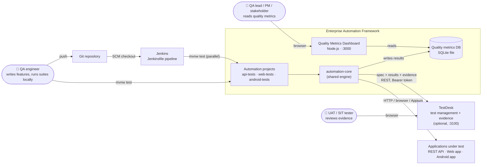
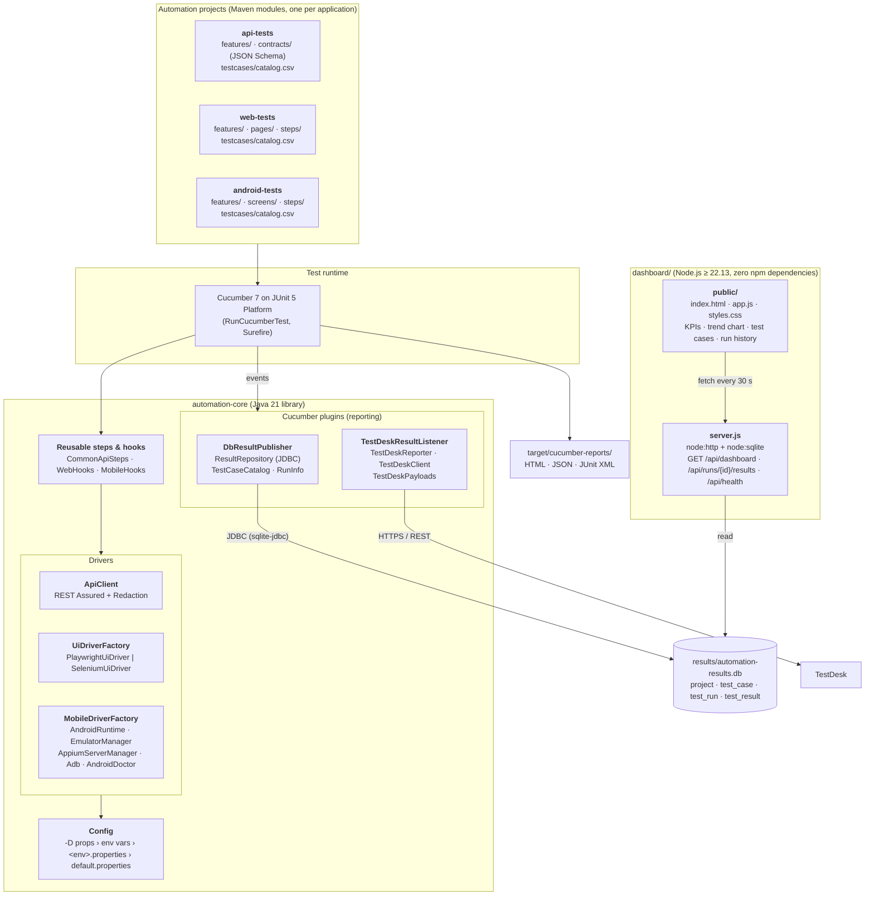
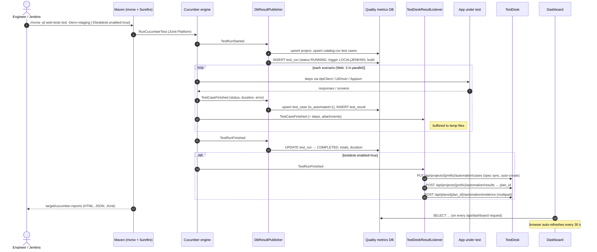
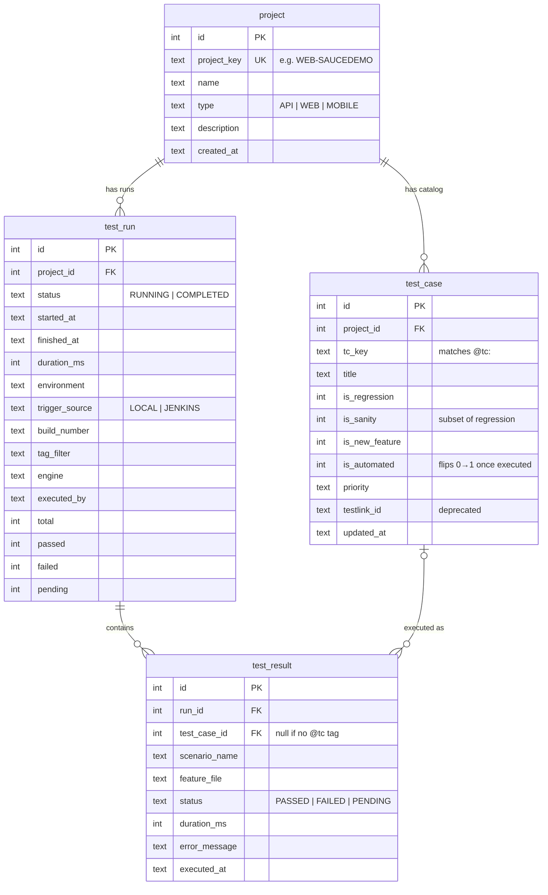
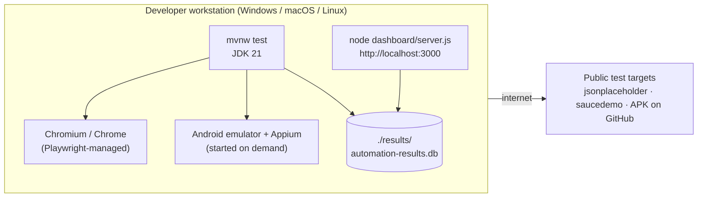
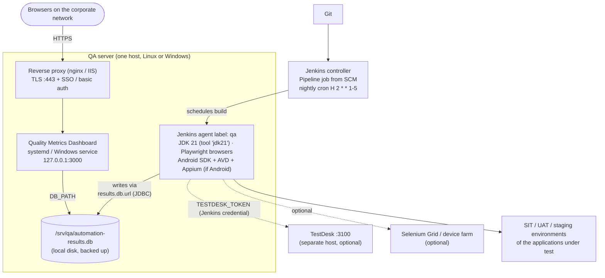
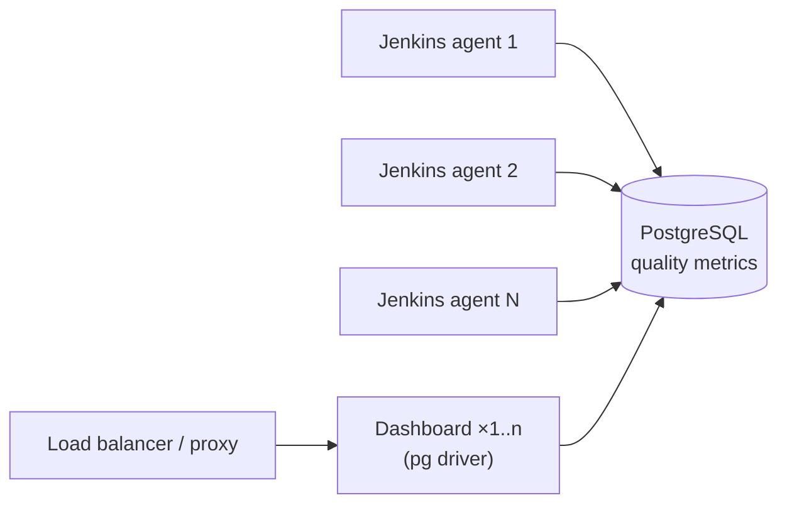
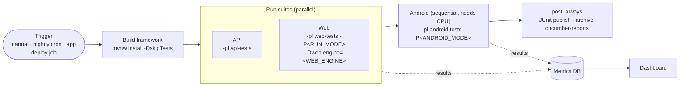

# Architecture: Enterprise Automation Framework + Quality Metrics Dashboard

This document describes how the framework, the automation projects, the Quality Metrics Dashboard and the
surrounding systems (Jenkins, TestDesk, the applications under test) fit together. For installation steps see
**[deployment-guide.md](deployment-guide.md)**.

All diagrams are [Mermaid](https://mermaid.js.org) and render directly on GitHub, GitLab and in IntelliJ / VS Code
Markdown previews.

---

## 1. System context

Who and what the platform talks to.

| External system | Interaction | Required? |
|---|---|---|
| Applications under test | REST Assured (API), Playwright or Selenium (Web), Appium UiAutomator2 (Android) | Yes |
| Jenkins | Checks out the repo, runs `Jenkinsfile`, archives Cucumber reports, publishes JUnit | For CI |
| TestDesk | Receives Gherkin specs, results and evidence at the end of each run | Optional (`testdesk.enabled`) |
| Selenium Grid / Appium device farm | Remote browsers / devices | Optional (`selenium.grid.url`, `mobile.mode=remote`) |

---

## 2. Logical components

### Responsibilities

| Component | Responsibility | Key files |
|---|---|---|
| **Config** | Layered settings; any key can be overridden by `-Dkey=value` or an upper-snake env var (`testdesk.url` → `TESTDESK_URL`) | `core/config/Config.java` |
| **ApiClient** | HTTP calls, JSON Schema contract checks, request/response evidence with secrets masked | `core/api/*` |
| **UiDriver** | One page-object API over Playwright or Selenium (local or Grid); headless or headed | `core/web/*` |
| **Mobile** | Starts/stops the emulator and Appium when needed, finds the Android SDK, builds capabilities, real-device and remote modes | `core/mobile/**` |
| **DbResultPublisher** | Syncs the project + catalog on run start, writes each scenario result, closes the run | `core/reporting/*` |
| **TestDeskResultListener** | At `TestRunFinished`: syncs specs (creates missing cases), posts results to a plan, uploads evidence | `core/testdesk/*` |
| **Dashboard server** | Read-only JSON API + static files over the same DB | `dashboard/server.js` |
| **Dashboard UI** | Filters (project, category), KPI tiles, success-rate trend, coverage, test-case and run drill-down | `dashboard/public/*` |

**Design rule:** reporting never breaks testing. Both `DbResultPublisher` and `TestDeskResultListener` log a WARN on
any failure (DB locked, TestDesk down, bad token) and the test run's own pass/fail is unaffected.

---

## 3. Runtime flow of one test run

---

## 4. Data model (quality metrics DB)

Schema source of truth: `automation-core/src/main/resources/db/schema.sql`. Both the framework and the dashboard
apply it with `CREATE TABLE IF NOT EXISTS`, so a new empty DB is created automatically.

### How the dashboard metrics are derived

| Metric | Query basis |
|---|---|
| Test cases | `test_case` rows for the selected project(s) and category |
| Automated / Coverage | `is_automated = 1` ÷ all test cases |
| Success rate, Passed / Failed / Pending | `test_result` rows of each project's **latest `COMPLETED` run** |
| Trend | Last 30 `COMPLETED` runs per project (`passed ÷ total`) |
| Test-case last result | Most recent `test_result` per `test_case` |

A run that crashes before `TestRunFinished` stays `RUNNING` and is left out of the KPIs, trend and run history.

---

## 5. Deployment views

### 5a. Developer workstation (default)

### 5b. Team / CI deployment (recommended for phase 1–2)

SQLite is a single file with WAL locking, which **only works on a local disk**. The Jenkins agent that runs the suites
and the dashboard therefore share one host (or one local volume).

### 5c. Target state: shared database, many agents (not implemented yet)

What it takes (see the deployment guide, §9): add the `org.postgresql:postgresql` driver to `automation-core`,
change `AUTOINCREMENT` to `GENERATED BY DEFAULT AS IDENTITY` in the schema, and replace `node:sqlite` with `pg` in
`dashboard/server.js`. The framework's SQL already uses portable `ON CONFLICT` upserts.

---

## 6. CI pipeline (Jenkinsfile)

Parameters: `SUITE`, `TAGS`, `TEST_ENV`, `WEB_ENGINE`, `RUN_MODE`, `ANDROID_MODE`, `ANDROID_APP`, `RESULTS_DB_URL`.
Tests are run with `-Dmaven.test.failure.ignore=true`, so a failing scenario marks the build **UNSTABLE**
(via the JUnit step) rather than aborting later stages.

---

## 7. Security notes

| Concern | Current state | Recommendation |
|---|---|---|
| Dashboard access | No authentication; listens on all interfaces on `PORT` | Bind behind a reverse proxy with TLS and SSO/basic auth, or firewall port 3000 |
| Dashboard data | Read-only API; path traversal guarded (`/public` only) | Fine to expose internally once behind the proxy |
| TestDesk token | Read only from env `TESTDESK_TOKEN`, never from properties files | Store as a Jenkins *Secret text* credential; use a dedicated `ci-bot` user |
| API evidence | `Redaction` masks `Authorization`, `password`, `token` fields | Review before attaching evidence from production-like data |
| Test accounts | Public demo credentials in `default.properties` | For real apps, inject credentials via env vars / Jenkins credentials |
