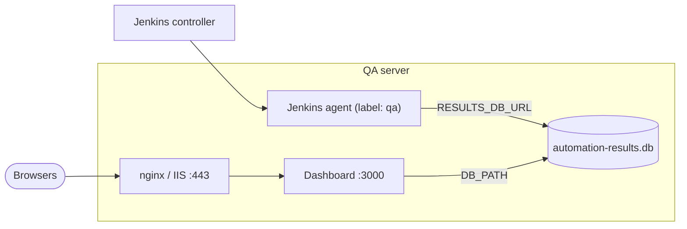

# Deployment guide: Enterprise Automation Framework + Quality Metrics Dashboard

How to install, run and operate the framework, the Jenkins pipeline and the Quality Metrics Dashboard, from a single
laptop to a shared QA server. Architecture and diagrams are in **[architecture.md](architecture.md)**; Android device
setup is in **[android-setup.md](android-setup.md)**.

**Contents**

1. [Choose a topology](#1-choose-a-topology)
2. [Prerequisites](#2-prerequisites)
3. [Get and build the framework](#3-get-and-build-the-framework)
4. [Deploy the Quality Metrics Dashboard](#4-deploy-the-quality-metrics-dashboard)
5. [Configure the Jenkins pipeline](#5-configure-the-jenkins-pipeline)
6. [Connect TestDesk (optional)](#6-connect-testdesk-optional)
7. [Configure environments and secrets](#7-configure-environments-and-secrets)
8. [Verify the deployment](#8-verify-the-deployment)
9. [Operations: backup, upgrade, scaling](#9-operations-backup-upgrade-scaling)
10. [Troubleshooting](#10-troubleshooting)
11. [Reference: settings and ports](#11-reference-settings-and-ports)

---

## 1. Choose a topology

| Topology | Use it for | Database | Where the dashboard runs |
|---|---|---|---|
| **A. Local** | Writing and debugging tests | `./results/automation-results.db` | `node dashboard/server.js` on the same machine |
| **B. Single QA server** *(recommended)* | Team metrics, nightly regression, demos to stakeholders | SQLite file on the QA server's **local** disk | Same host as the Jenkins agent, as a service behind a reverse proxy |
| **C. Shared DB** *(future)* | Many Jenkins agents on different hosts | PostgreSQL | Any host; needs code changes, see [§9.4](#94-scaling-out-postgresql) |

> **Why the dashboard and the agent share a host in B.** The results DB is SQLite in WAL mode. WAL locking
> needs a local filesystem; putting the file on an SMB/NFS share causes `database is locked` errors or corruption.
> Every component that writes or reads it must run on the machine that owns the disk.



---

## 2. Prerequisites

### 2.1 Software

| Component | Version | Needed on | Notes |
|---|---|---|---|
| JDK | **21** | Every machine that runs tests | `JAVA_HOME` must point to it (`mvnw` uses it). Jenkins: a JDK tool named **`jdk21`** |
| Maven | *none* | – | The wrapper (`mvnw` / `mvnw.cmd`) downloads Maven 3.9 on first use |
| Node.js | **≥ 22.13** | Dashboard host | Uses the built-in `node:sqlite`; **no `npm install`** needed |
| Git | any | Agents, dashboard host | |
| Google Chrome | current | Web agents using `RUN_MODE=chrome` | Headless mode uses the Playwright-bundled Chromium instead |
| Android SDK, AVD, Appium 3 + UiAutomator2, Node.js | see [android-setup.md](android-setup.md) | Android agents only | KVM on Linux, Hypervisor Platform on Windows |
| Jenkins | 2.4xx LTS + plugins *Pipeline*, *JUnit*, *Timestamper* | CI | *Credentials Binding* if TestDesk is used |
| Reverse proxy | nginx / Apache / IIS | Dashboard host (topology B) | TLS + authentication, because the dashboard has none |

### 2.2 Sizing (topology B)

| Load | CPU | RAM | Disk |
|---|---|---|---|
| API + Web suites (3 parallel browsers) | 4 vCPU | 8 GB | 10 GB (Maven repo, browsers, reports) |
| + Android emulator | 8 vCPU with virtualization | 16 GB | + 15 GB (SDK, system image, AVD) |
| Dashboard | negligible | < 200 MB | DB grows ~1 MB per few hundred runs |

### 2.3 Network access from agents

| Destination | Why |
|---|---|
| Maven Central (`repo.maven.apache.org`) | Dependencies, Maven wrapper |
| `playwright.azureedge.net` / `cdn.playwright.dev` | Playwright browser download on first run (cached in `~/.cache/ms-playwright`) |
| Selenium Manager endpoints (`googlechromelabs.github.io`, `storage.googleapis.com`) | Driver download when `web.engine=selenium` |
| `github.com` | Default Android APK URL (or set `mobile.app` to a local `.apk`) |
| The applications under test, TestDesk, Selenium Grid | As configured |

Behind a corporate proxy, set `MAVEN_OPTS="-Dhttps.proxyHost=… -Dhttps.proxyPort=…"` and `HTTPS_PROXY` for
Playwright. In air-gapped networks, mirror Maven Central (Nexus/Artifactory) and pre-install browsers with
`PLAYWRIGHT_BROWSERS_PATH` pointing to a shared folder.

---

## 3. Get and build the framework

```bash
git clone <your-git-url>/enterprise-automation-framework.git
```

```bash
cd enterprise-automation-framework
```

```bash
./mvnw install -DskipTests
```

On Windows use `mvnw.cmd`. This compiles `automation-core` and the test modules and installs the core into the local
Maven repository (`~/.m2`). Run the core's own unit tests with `./mvnw -pl automation-core test`.

Smoke-run the pilots (internet needed for the public demo targets):

```bash
./mvnw -pl api-tests test
```

```bash
./mvnw -pl web-tests test
```

Each run creates or appends to `results/automation-results.db` and writes reports to
`<module>/target/cucumber-reports/`.

---

## 4. Deploy the Quality Metrics Dashboard

The dashboard is `dashboard/server.js` plus static files in `dashboard/public/`. It has no npm dependencies and reads
the same SQLite file the framework writes.

| Env var | Default | Meaning |
|---|---|---|
| `PORT` | `3000` | HTTP port (listens on all interfaces) |
| `DB_PATH` | `<repo>/results/automation-results.db` | Absolute path of the results DB. Created, with its folder, if missing |

On start the server applies `automation-core/src/main/resources/db/schema.sql` if the file exists, so **deploy the
whole repository checkout** (not just `dashboard/`), or make sure the DB was created by a test run first.

### 4.1 Local (topology A)

```bash
node dashboard/server.js
```

Or `npm start` inside `dashboard/` (hides the `node:sqlite` experimental warning). Open http://localhost:3000.

### 4.2 Linux service with systemd (topology B)

1. Create a service user and folders:

   ```bash
   sudo useradd --system --create-home --home-dir /opt/eaf --shell /usr/sbin/nologin eaf
   ```

   ```bash
   sudo mkdir -p /srv/qa && sudo chown jenkins:eaf /srv/qa && sudo chmod 2775 /srv/qa
   ```

   The Jenkins agent user (`jenkins` here) writes the DB; the `eaf` group lets the dashboard read it. WAL mode
   also needs **write** access to the folder for the `-wal` / `-shm` files, hence `2775` on the folder.

2. Check out the repo for the dashboard:

   ```bash
   sudo -u eaf git clone <your-git-url>/enterprise-automation-framework.git /opt/eaf/app
   ```

3. Create `/etc/systemd/system/eaf-dashboard.service`:

   ```ini
   [Unit]
   Description=EAF Quality Metrics Dashboard
   After=network.target

   [Service]
   User=eaf
   Group=eaf
   WorkingDirectory=/opt/eaf/app/dashboard
   Environment=PORT=3000
   Environment=DB_PATH=/srv/qa/automation-results.db
   ExecStart=/usr/bin/node --disable-warning=ExperimentalWarning server.js
   Restart=on-failure
   RestartSec=5
   UMask=0002

   [Install]
   WantedBy=multi-user.target
   ```

4. Start it:

   ```bash
   sudo systemctl daemon-reload && sudo systemctl enable --now eaf-dashboard
   ```

   ```bash
   curl -s http://127.0.0.1:3000/api/health
   ```

   Expected: `{"status":"UP","database":"/srv/qa/automation-results.db"}`.

### 4.3 Windows service (topology B on a Windows agent)

Using [NSSM](https://nssm.cc) (or WinSW):

```bat
nssm install EAF-Dashboard "C:\Program Files\nodejs\node.exe" "--disable-warning=ExperimentalWarning" "C:\qa\eaf\dashboard\server.js"
```

```bat
nssm set EAF-Dashboard AppDirectory C:\qa\eaf\dashboard
```

```bat
nssm set EAF-Dashboard AppEnvironmentExtra PORT=3000 DB_PATH=C:\qa\automation-results.db
```

```bat
nssm start EAF-Dashboard
```

Give the Jenkins agent's service account *Modify* rights on `C:\qa\`, and the dashboard service account at least
*Modify* on the same folder (WAL needs it).

### 4.4 Reverse proxy with TLS and authentication

The dashboard has **no login**. Either keep port 3000 firewalled to localhost and publish it through a proxy, or
restrict it to a trusted network.

nginx example (`/etc/nginx/conf.d/qa-dashboard.conf`):

```nginx
server {
    listen 443 ssl;
    server_name qa-dashboard.example.internal;

    ssl_certificate     /etc/ssl/certs/qa-dashboard.crt;
    ssl_certificate_key /etc/ssl/private/qa-dashboard.key;

    # Basic auth; replace with your SSO (oauth2-proxy, Keycloak, AD/LDAP module) if available
    auth_basic           "Quality Metrics";
    auth_basic_user_file /etc/nginx/qa-dashboard.htpasswd;

    location / {
        proxy_pass         http://127.0.0.1:3000;
        proxy_set_header   Host $host;
        proxy_set_header   X-Forwarded-For $proxy_add_x_forwarded_for;
        proxy_set_header   X-Forwarded-Proto $scheme;
    }

    location = /api/health {          # unauthenticated, for monitoring
        auth_basic off;
        proxy_pass http://127.0.0.1:3000;
    }
}
```

Then block direct access, e.g. `sudo ufw deny 3000` (or Windows Defender Firewall inbound rule).

### 4.5 Container (optional)

The dashboard runs unchanged in a container, but the DB must be on a **local volume of the same host** as the Jenkins
agent writing it:

```dockerfile
FROM node:22-alpine
WORKDIR /app
COPY dashboard/ dashboard/
COPY automation-core/src/main/resources/db/schema.sql automation-core/src/main/resources/db/schema.sql
ENV PORT=3000 DB_PATH=/data/automation-results.db
EXPOSE 3000
USER node
CMD ["node", "--disable-warning=ExperimentalWarning", "dashboard/server.js"]
```

```bash
docker build -f Dockerfile.dashboard -t eaf-dashboard .
```

```bash
docker run -d --name eaf-dashboard --restart unless-stopped -p 127.0.0.1:3000:3000 -v /srv/qa:/data eaf-dashboard
```

The image's `node` user (uid 1000) needs write access to `/srv/qa`.

---

## 5. Configure the Jenkins pipeline

### 5.1 One-time Jenkins setup

| Step | Where | Value |
|---|---|---|
| JDK tool | *Manage Jenkins › Tools › JDK installations* | Name **`jdk21`**, JDK 21 (install automatically or path) |
| Agent | *Manage Jenkins › Nodes* | Agent on the QA server (topology B). Give it a label such as `qa`, plus `android` if it has the SDK/AVD |
| Plugins | *Manage Jenkins › Plugins* | Pipeline, JUnit, Timestamper, Credentials Binding, Git |
| Credential (TestDesk) | *Manage Jenkins › Credentials* | *Secret text*, ID **`TESTDESK_TOKEN`** (see §6) |

The `Jenkinsfile` uses `agent any`. On a multi-node Jenkins, pin it to the QA server so results land in the DB the
dashboard reads: change the first lines to `agent { label 'qa' }`, or restrict the job to that node.

### 5.2 Create the job

1. *New Item › Pipeline*, name e.g. `eaf-regression`.
2. *Pipeline › Definition:* **Pipeline script from SCM**, Git, your repository URL and branch, *Script Path* `Jenkinsfile`.
3. Save and click **Build Now** once. The first build only registers the parameters; from the second build on, use
   **Build with Parameters**.
4. Point every build (including the nightly cron, which runs with parameter defaults) at the dashboard's DB. Either
   set the default of the `RESULTS_DB_URL` parameter in the `Jenkinsfile` to e.g.
   `jdbc:sqlite:/srv/qa/automation-results.db`, or set an agent-level environment variable
   `MAVEN_ARGS=-Dresults.db.url=jdbc:sqlite:/srv/qa/automation-results.db`
   (*Nodes › qa › Configure › Environment variables*; Maven 3.9 adds `MAVEN_ARGS` to every `mvnw` call).

   > A plain `RESULTS_DB_URL` env var is **not** enough: Surefire always passes `results.db.url` as a system
   > property (default `<workspace>/results/…`), and system properties win over env vars. The same applies to
   > `env`, `browser`, `headless` and `mobile.mode`; set those with `-D` / Maven profiles, not env vars.

### 5.3 Parameters

| Parameter | Values | Effect |
|---|---|---|
| `SUITE` | `all`, `api`, `web`, `android` | Which modules run. API and Web run in parallel; Android runs afterwards |
| `TAGS` | Cucumber tag expression | e.g. `@sanity`, `@regression and not @wip`, `@tc:WEB-007` |
| `TEST_ENV` | `local`, `staging`, `production` | Loads `config/<env>.properties` in each module |
| `WEB_ENGINE` | `playwright`, `selenium` | Web automation engine |
| `RUN_MODE` | `headless`, `chrome` | `chrome` needs Google Chrome and an interactive desktop session on the agent |
| `ANDROID_MODE` | `headless`, `emulator`, `device` | `headless` for CI; see [android-setup.md §5](android-setup.md) |
| `ANDROID_APP` | path or URL | Overrides `mobile.app` |
| `RESULTS_DB_URL` | JDBC URL | Dashboard DB, e.g. `jdbc:sqlite:/srv/qa/automation-results.db` or `jdbc:sqlite:C:/qa/automation-results.db` |
| `TESTLINK` | – | **Legacy, leave unchecked.** TestLink was replaced by TestDesk; see §6 for enabling TestDesk |

### 5.4 Triggers

* **Nightly regression:** built in, `cron('H 2 * * 1-5')` (≈ 02:00 Mon–Fri, agent time zone).
* **Sanity after an application deploy:** from the application's deploy job:

  ```groovy
  build job: 'eaf-regression', wait: false, parameters: [
      string(name: 'SUITE', value: 'all'),
      string(name: 'TAGS', value: '@sanity'),
      string(name: 'TEST_ENV', value: 'staging')
  ]
  ```

### 5.5 What a build produces

| Output | Where |
|---|---|
| JUnit results / trend | Build page (*Test Result*) – failures mark the build **UNSTABLE** |
| Cucumber HTML / JSON / XML, screenshots | *Build Artifacts* › `**/target/cucumber-reports/**` |
| Metrics | Dashboard: new run with `trigger_source=JENKINS` and the build number |
| TestDesk plan | When enabled, logged as `TestDesk plan #N: … recorded` with a link |

---

## 6. Connect TestDesk (optional)

TestDesk receives test specifications (Gherkin steps), results and evidence at the end of each run. Design details:
[design-testdesk-integration.md](design-testdesk-integration.md).

### 6.1 Prepare TestDesk

1. Run TestDesk on a port that doesn't clash with the dashboard, e.g. **3100**.
2. Create the projects with prefixes matching the modules: `API`, `WEB`, `AND` (`testdesk.project` in each
   `config/default.properties`).
3. Create a dedicated user (e.g. `ci-bot`, role tester) and generate an API token for it.
4. *(Optional)* To keep our IDs (`API-001`) for automatically created cases, apply
   [`testdesk-keep-case-key.patch`](testdesk-keep-case-key.patch) to TestDesk. Without it TestDesk assigns its own
   numbers and links them through `automation_ref`.

### 6.2 Enable it

Every setting can come from `-D`, an env var, or `config/<env>.properties`. The token comes **only** from the
`TESTDESK_TOKEN` env var.

Locally:

```bash
export TESTDESK_TOKEN=<token>
```

```bash
./mvnw -pl api-tests test -Dtestdesk.enabled=true -Dtestdesk.url=http://testdesk.example.internal:3100 -Dtestdesk.environment=SIT
```

In Jenkins (the current `Jenkinsfile` has no TestDesk parameter yet), set these on the agent or the job and bind the
credential:

| Env var | Example |
|---|---|
| `TESTDESK_ENABLED` | `true` |
| `TESTDESK_URL` | `http://testdesk.example.internal:3100` |
| `TESTDESK_ENVIRONMENT` | `SIT` or `UAT` |
| `TESTDESK_PLAN_NAME` | *(optional)* `Release 2.4` – default is `EAF <project.key> <env>` |
| `EVIDENCE_MODE` | `failed` (default) or `all` for UAT |
| `TESTDESK_TOKEN` | from the `TESTDESK_TOKEN` *Secret text* credential |

Wrapping the stages in `withCredentials([string(credentialsId: 'TESTDESK_TOKEN', variable: 'TESTDESK_TOKEN')])` exposes
the token; `BUILD_NUMBER`, `BUILD_URL` and `BUILD_TAG` are picked up automatically as build, CI link and idempotent
run id.

### 6.3 Failure behaviour

TestDesk problems (down, 401, closed plan) are logged as WARN and **never** fail the test run. The payloads are kept
in `<module>/target/testdesk/` for re-sending. Use `-Dtestdesk.dry.run=true` to validate against TestDesk without
storing anything.

---

## 7. Configure environments and secrets

### 7.1 Lookup order

`Config` resolves every key in this order (first hit wins):

1. JVM system property: `-Dweb.base.url=https://staging.example.com`
2. Env var, upper-snake: `WEB_BASE_URL=…`
3. `config/<env>.properties` (`-Denv=staging`; default `local`)
4. `config/default.properties`

When tests run through Maven, Surefire always sets `env`, `results.db.url`, `browser`, `headless` (web-tests) and
`mobile.mode` (android-tests) as system properties, so **those five keys must be given with `-D` or a Maven
profile**; their env vars (`TEST_ENV`, `RESULTS_DB_URL`, …) are ignored. Every other key can come from an env var.

### 7.2 Adding an environment

Create `config/staging.properties` (and `production.properties` if needed) in each module, overriding only what
differs:

```properties
# web-tests/src/test/resources/config/staging.properties
web.base.url=https://staging.shop.example.com
web.timeout.ms=15000
```

```properties
# api-tests/src/test/resources/config/staging.properties
api.base.url=https://staging-api.example.com
```

The Jenkins `TEST_ENV` choice already offers `local`, `staging`, `production`.

### 7.3 Secrets

Never commit secrets to properties files. Inject them as env vars (Jenkins credentials, or the agent's environment):

| Secret | Env var |
|---|---|
| TestDesk API token | `TESTDESK_TOKEN` |
| Application test-user passwords | e.g. `WEB_USER_PASSWORD`, `MOBILE_USER_PASSWORD` (overrides `web.user.password`, …) |
| Selenium Grid / device farm credentials | in the URL or `mobile.cap.*` via env, e.g. `SELENIUM_GRID_URL` |

---

## 8. Verify the deployment

Work through this checklist after installing or upgrading.

| # | Check | How | Expected |
|---|---|---|---|
| 1 | Framework builds | `./mvnw install -DskipTests` on the agent | `BUILD SUCCESS` |
| 2 | Core unit tests | `./mvnw -pl automation-core test` | All green |
| 3 | Dashboard up | `curl http://127.0.0.1:3000/api/health` | `{"status":"UP","database":"<DB_PATH>"}` |
| 4 | Same DB on both sides | Compare `database` above with `RESULTS_DB_URL` | Identical absolute path |
| 5 | Proxy + auth | Open `https://qa-dashboard…/` in a browser | Login prompt, then the dashboard |
| 6 | Port 3000 closed | From another machine: `curl http://<server>:3000/` | Connection refused / timed out |
| 7 | Jenkins → DB | Build with `SUITE=api`, then refresh the dashboard | New run, *Trigger* `JENKINS`, build number shown |
| 8 | Web suite | Build with `SUITE=web` | 10/10 scenarios; screenshots on failures |
| 9 | Android (if used) | `AndroidDoctor` on the agent ([android-setup.md §2](android-setup.md)), then `SUITE=android` | Doctor all OK; 10/10 |
| 10 | Nightly cron | Next morning, Jenkins build history | Build started ≈ 02:00 |
| 11 | TestDesk (if used) | Build with TestDesk env vars set | Log: `TestDesk plan #N: 10 recorded, 0 unmatched` |
| 12 | Backup | Run the backup job once (§9.1) and restore to a temp path | Restored DB opens on the dashboard with `DB_PATH=<tmp>` |

---

## 9. Operations: backup, upgrade, scaling

### 9.1 Backup

The DB is one file plus WAL side files. Take an online, consistent copy with SQLite's backup command rather than
copying the file while a run is writing:

```bash
sqlite3 /srv/qa/automation-results.db ".backup '/srv/qa/backup/automation-results-$(date +%F).db'"
```

(`sqlite3` is the SQLite CLI: `apt install sqlite3`, or the Windows binary from sqlite.org.)
Schedule it daily (cron / Windows Task Scheduler, or a small Jenkins job after the nightly build) and keep e.g. 14
copies. Cucumber reports are kept by Jenkins (`buildDiscarder` keeps the last 30 builds).

### 9.2 Upgrade

1. Pull the new version on the dashboard host: `git -C /opt/eaf/app pull`.
2. Restart: `sudo systemctl restart eaf-dashboard` (or `nssm restart EAF-Dashboard`).
3. Jenkins picks up the new `Jenkinsfile` and framework code on the next build automatically.
4. Schema changes are additive `CREATE … IF NOT EXISTS`; there are no migrations to run. Back up first anyway.

### 9.3 Data hygiene

* **Throw-away runs:** `-Dresults.db.enabled=false` keeps experiments out of the metrics.
* **Stuck runs:** runs interrupted before the end stay `RUNNING` and are left out of the KPIs, trend and run history
  (their individual results can still show as a test case's *last result*). Clean them up
  occasionally: `DELETE FROM test_result WHERE run_id IN (SELECT id FROM test_run WHERE status='RUNNING' AND started_at < date('now','-1 day')); DELETE FROM test_run WHERE status='RUNNING' AND started_at < date('now','-1 day');`
* **Catalog:** keep each module's `testcases/catalog.csv` in sync with test management; it is the denominator of
  automation coverage.

### 9.4 Scaling out: PostgreSQL

Needed when suites run on several agents/hosts that can't share a local disk. Not implemented or tested yet; the work
is:

| Side | Change |
|---|---|
| Schema | `INTEGER PRIMARY KEY AUTOINCREMENT` → `BIGINT GENERATED BY DEFAULT AS IDENTITY PRIMARY KEY` |
| Framework | Add `org.postgresql:postgresql` to `automation-core/pom.xml`; set `RESULTS_DB_URL=jdbc:postgresql://db:5432/qa?user=eaf&password=…` (via env). SQL already uses `ON CONFLICT` upserts |
| Dashboard | Replace `node:sqlite` (`DatabaseSync`) with the `pg` package (async queries); add `package.json` dependency and `npm ci` to the deployment |

### 9.5 Onboarding a new automation project

1. Copy `api-tests/` or `web-tests/`, rename the `artifactId`, add it to `<modules>` in the root `pom.xml`.
2. Set `project.key`, `project.name`, `project.type` in its `config/default.properties` (and `testdesk.project`).
3. Replace `testcases/catalog.csv`; tag every scenario `@tc:<ID>` plus category tags.
4. Add a stage for it in the `Jenkinsfile` (and to the `SUITE` choices).
5. Run it once: the project appears on the dashboard automatically.

---

## 10. Troubleshooting

| Symptom | Likely cause | Fix |
|---|---|---|
| Dashboard shows no projects / no runs | Dashboard and tests use different DB files | Compare `/api/health` → `database` with the `Publishing results to …` line in the Maven log |
| `SQLITE_BUSY` / `database is locked` | DB on a network share, or a long-running reader | Move the DB to a local disk; WAL + `busy_timeout=5000` handle normal concurrency |
| `attempt to write a readonly database` (dashboard or test log) | Folder not writable by both users (WAL creates `-wal`/`-shm`) | Fix folder permissions (§4.2 step 1) |
| `Result publishing disabled for this run: …` in the test log | DB path invalid / unwritable | Check `RESULTS_DB_URL`; tests still run, the run is just not recorded |
| `node: No such built-in module: node:sqlite` | Node < 22.13 | Upgrade Node.js |
| Run appears in Jenkins but not on dashboard | Run did not reach `TestRunFinished` (aborted / timeout) | It stays `RUNNING`; check the 60-minute pipeline timeout and the console log |
| `Executable doesn't exist at …ms-playwright…` | Browsers not downloaded (no internet on agent) | Allow the Playwright CDN or pre-install with `PLAYWRIGHT_BROWSERS_PATH` |
| `RUN_MODE=chrome` fails on agent | Agent runs as a service without a desktop / Chrome missing | Use `headless` in CI, or run the agent in an interactive session |
| Android stage fails to boot emulator | No hardware acceleration / AVD missing | Run `AndroidDoctor`; see [android-setup.md](android-setup.md) |
| `TestDesk reporting disabled: missing configuration [testdesk.token]` | `TESTDESK_TOKEN` not in the environment | Bind the Jenkins credential / export the variable |
| TestDesk `409` on results | Plan is closed | Set a new `TESTDESK_PLAN_NAME` |
| Port 3000 already in use | TestDesk or another app on 3000 | `PORT=3001`, or move TestDesk to 3100 |

Logs: dashboard → `journalctl -u eaf-dashboard -f` (Linux) or the NSSM log; framework → Maven console / Jenkins
console (`logback.xml` in `automation-core`).

---

## 11. Reference: settings and ports

### Ports

| Port | Service | Exposure |
|---|---|---|
| 443 | Reverse proxy → dashboard | Corporate network |
| 3000 | Dashboard (`PORT`) | localhost only |
| 3100 | TestDesk (suggested) | Agents + testers |
| 4723 | Appium (started on demand) | localhost on Android agents |
| 5554–5585 | Android emulator console/adb | localhost on Android agents |

### Most-used framework settings

"`-D` only" = Surefire always sets it, so an env var has no effect under Maven (see §7.1).

| Key (`-D`) | Env var | Default |
|---|---|---|
| `env` | `-D` only | `local` |
| `results.db.url` | `-D` only (or `MAVEN_ARGS`) | `jdbc:sqlite:<repo>/results/automation-results.db` |
| `results.db.enabled` | `RESULTS_DB_ENABLED` | `true` |
| `cucumber.filter.tags` | – | *(all)* |
| `web.engine` | `WEB_ENGINE` | `playwright` |
| `browser` / `headless` | `-D` only / profiles `-Pheadless`, `-Pchrome` | `chromium` / `true` |
| `selenium.grid.url` | `SELENIUM_GRID_URL` | – |
| `mobile.mode` | `-D` only / profiles `-Pemulator`, `-Pheadless`, `-Pdevice`, `-Premote` | `emulator` |
| `testdesk.enabled` | `TESTDESK_ENABLED` | `false` |
| `testdesk.url` | `TESTDESK_URL` | `http://localhost:3100` |
| `testdesk.token` | `TESTDESK_TOKEN` | – (env only) |
| `evidence.mode` | `EVIDENCE_MODE` | `failed` |

### Dashboard

| Env var | Default |
|---|---|
| `PORT` | `3000` |
| `DB_PATH` | `<repo>/results/automation-results.db` |

API: `GET /api/dashboard`, `GET /api/runs/{id}/results`, `GET /api/health`.
